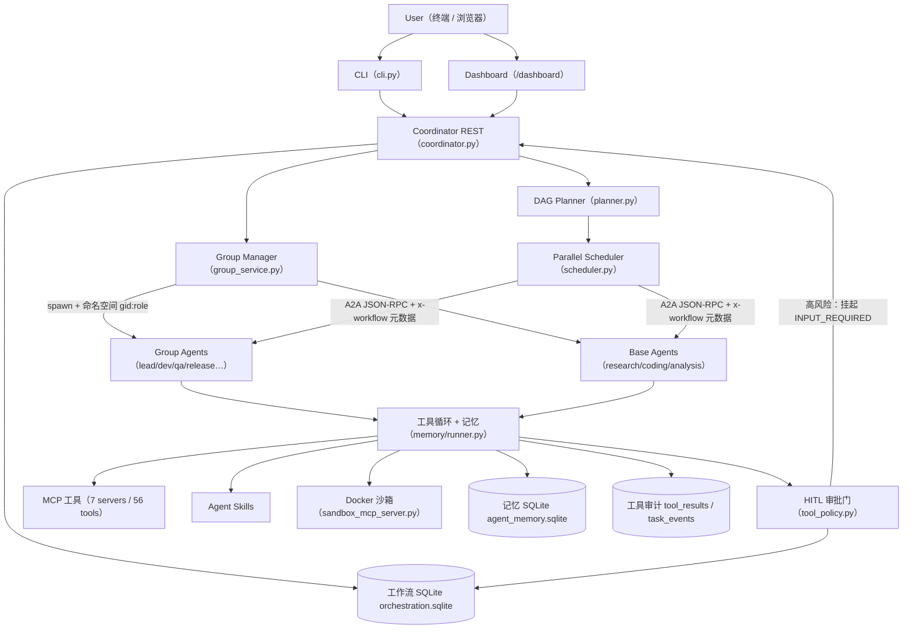

# Multi-Agent System — A2A + MCP + Skills + Memory 多 Agent 协作平台

> 本 README 面向接手的同伴：几分钟理解「原版有什么 / 新增了什么 / 每项对应哪些代码 /
> 验证到什么程度 / 如何启动与继续开发」。安装步骤保留在 §9，运行指南在 §10。
> 详细测试证据见 [docs/INTEGRATION_ACCEPTANCE_REPORT.md](docs/INTEGRATION_ACCEPTANCE_REPORT.md)
> 与 [docs/MID_TEST_LOCAL_TRIAL_REPORT.md](docs/MID_TEST_LOCAL_TRIAL_REPORT.md)。

适用环境：**WSL2 / Ubuntu、Python 3.12、Node.js 24、Docker（沙箱执行需要）**。
源码：[AlanFang233/multi-agent-system](https://github.com/AlanFang233/multi-agent-system)，
开发分支 `feature/agentforge-capabilities`。

---

## 1. Project Overview

这是一个基于 **A2A 协议、MCP 工具注册表、Agent Skills 与 SQLite 长期记忆** 的多 Agent
协作平台。原始版本提供三个固定角色 Agent（research / coding / analysis）之间的自主委托与
工具执行能力。

在此基础之上新增了**增强层**（不替换原架构，全部以叠加方式接入）：

- **Coordinator**：统一 REST 入口 + 交互式 Dashboard
- **DAG Planner 与 Parallel Scheduler**：目标 → 有向无环图 → 能力全覆盖分配 → 并行执行
- **Dynamic Groups / Dynamic Role Agents**：按需创建具名团队（如 4 角色开发组），独立
  Role Prompt、独立进程、命名空间隔离
- **Workflow 持久化与崩溃恢复**：SQLite（WAL + CAS + 租约）
- **HITL 人工审批与澄清**：高风险工具在 Agent 进程内的工具执行边界被拦截，摘要绑定、
  一次性消费；澄清走 A2A `INPUT_REQUIRED`
- **Memory Evolution**：证据分级、混合检索、晋升/衰减/反馈
- **统一实时 CLI**：提交、跟随、审批、澄清、Group 管理

这些是**增强功能**；§3 明确区分原版已有与新增内容。

## 2. System Architecture



**协作方式**：Coordinator 把用户目标交给 Planner 生成 DAG（Kahn 拓扑校验），
CapabilityAssigner 按能力全覆盖把节点分配给 Agent；Scheduler 以单写者模型并行派发，
派发走**真实 A2A JSON-RPC**，并在 `x-workflow` 元数据中携带 `task_id`（幂等键
`{workflow}:{node}:{attempt}`）、审批令牌与澄清答案。节点结果与工具证据回流到
Workflow Store；综合节点（synthesis）只允许引用下游真实结果。

**人类如何参与**：高风险工具调用（写文件/编辑/建目录/沙箱执行）在 Agent 进程内被审批门
拦截 → A2A 任务转 `INPUT_REQUIRED` → Dashboard/CLI 展示待审批项（含参数摘要与 SHA-256
摘要绑定）→ 批准后令牌随重放注入、一次性消费后真正执行；拒绝则节点 FAILED 并级联下游。
澄清同理：Agent 以 `[[CLARIFY: …]]` 挂起，回答后以低信任参考材料注入上下文恢复。

## 3. Original Version vs Enhanced Version

| Feature | Original | Enhanced | Status |
|---|---|---|---|
| A2A Communication（JSON-RPC，3 base agents） | ✅ | 保留 + `x-workflow` 元数据扩展 | VERIFIED |
| MCP Registry（7 servers / 56 tools / 角色白名单） | ✅ | 保留 + 组级生成注册表 | VERIFIED |
| Agent Skills（load + execute） | ✅ | 保留 | VERIFIED |
| Docker Sandbox（network-none / read-only / cap-drop） | ✅ | 保留 + 超时钳制修复 | VERIFIED |
| SQLite 双层记忆（checkpoint + 长期记忆） | ✅ | 保留 + Evolution 层 | VERIFIED |
| 原始 Agent 自主委托（a2a:delegate_task） | ✅ | 保留（工作流模式不启用） | VERIFIED |
| Coordinator REST + Dashboard | — | 新增 | VERIFIED |
| Dynamic DAG Planning（LLM planner + 校验） | — | 新增 | VERIFIED |
| Parallel Scheduler（单写者 + 屏障可证并发） | — | 新增 | VERIFIED |
| Capability Assignment（全覆盖 + 确定性 tie-break） | — | 新增 | VERIFIED |
| Workflow Store（SQLite WAL/CAS/租约/恢复） | — | 新增 | VERIFIED |
| HITL Approval（摘要绑定 + 一次性消费 + 级联拒绝） | — | 新增 | VERIFIED |
| Clarification（INPUT_REQUIRED 映射） | — | 新增 | PARTIAL（Mock 验证；真实模型未触发，见 §8） |
| Pause / Resume / Cancel | — | 新增 | TESTED |
| Memory Evolution（分级/混合检索/晋升/衰减） | — | 新增 | PARTIAL（套件验证；默认未接入主路径） |
| Dynamic Groups + Role Prompt Injection + 隔离 | — | 新增 | VERIFIED |
| 统一实时 CLI | — | 新增 | VERIFIED |
| A2A TaskStore 持久化 | — | 目标项 | PARTIAL（InMemory；sdk 1.3.0 不兼容，见 §8） |

Status 语义：**VERIFIED** = 真实运行时 E2E 证据；**TESTED** = 自动化测试通过；
**PARTIAL** = 可用但有明确缺口；**NOT TESTED** = 本轮无证据。

## 4. New Features and Source Code Mapping

**Coordinator & REST & Dashboard**
统一入口：工作流提交/查询/取消/暂停/恢复、审批与澄清决策、Group 生命周期、内嵌
Dashboard（DAG 树、审批/澄清面板、MOCK 横幅）。崩溃后 `_ensure_workflow_running`
重新拉起调度器。
代码：[src/agent_ecosystem/coordinator.py](src/agent_ecosystem/coordinator.py)

**DAG Planner & Capability Assignment**
LLM 函数调用式规划（submit_plan），Kahn 拓扑/深度/规模校验，能力全覆盖分配与确定性
tie-break；能力缺口在目录内可拆分时给予有界修复反馈。
代码：[src/agent_ecosystem/orchestration/planner.py](src/agent_ecosystem/orchestration/planner.py)、
[assignment.py](src/agent_ecosystem/orchestration/assignment.py)

**Parallel Scheduler & 状态机**
单写者 asyncio 调度：并行派发、WAITING_INPUT 轮询、级联清扫、租约/重试/改派预算、
整工作流 deadline；节点状态迁移严格受状态机约束（含 `WAITING_INPUT → FAILED` 拒绝路径）。
代码：[scheduler.py](src/agent_ecosystem/orchestration/scheduler.py)、
[state_machine.py](src/agent_ecosystem/orchestration/state_machine.py)、
[models.py](src/agent_ecosystem/orchestration/models.py)、
[errors.py](src/agent_ecosystem/orchestration/errors.py)

**Workflow Persistence & Recovery**
SQLite 存储（workflows/nodes/events/approvals/clarifications/reconciliations/a2a_tasks），
WAL + busy_timeout + CAS；`resume()` 重置崩溃残留 RUNNING 节点为重放、零节点工作流回退
重新规划；Agent 侧 checkpoint 保证同 `task_id` 重放不重复副作用。
代码：[sqlite_store.py](src/agent_ecosystem/orchestration/sqlite_store.py)、
[service.py](src/agent_ecosystem/orchestration/service.py)、
[store.py](src/agent_ecosystem/orchestration/store.py)、
[memory/store.py](src/agent_ecosystem/memory/store.py)、
[memory/context.py](src/agent_ecosystem/memory/context.py)

**HITL Approval & Clarification**
审批服务与仓库（决策/过期/取消）、摘要绑定与一次性消费（`tool_policy`）、挂起信号
（`suspension`）、Agent 工具边界强制执行与审批重放（恢复时按 checkpoint 原样重放被批准
调用，摘要绑定对非确定性模型同样成立）、澄清触发与回注。传输层：A2A 元数据归一化与
`return_status`。
代码：[hitl.py](src/agent_ecosystem/orchestration/hitl.py)、
[tool_policy.py](src/agent_ecosystem/orchestration/tool_policy.py)、
[suspension.py](src/agent_ecosystem/orchestration/suspension.py)、
[memory/runner.py](src/agent_ecosystem/memory/runner.py)、
[a2a_delegate.py](src/agent_ecosystem/a2a_delegate.py)、
[a2a_server.py](src/agent_ecosystem/a2a_server.py)

**Dynamic Groups & Role Agents**
Group 持久化（幂等创建）、按组生成 MCP/Agent 注册表与端口块、命名空间
`{group_id}:{role}`、子进程生命周期（启动/健康/停止/端口回收）、教师场景 4 角色模板、
Group 作用域 WorkflowService。Role Prompt 经 `system_prompt_override` 链注入
（a2a_server → tool_agent → runner）。
代码：[group_service.py](src/agent_ecosystem/orchestration/group_service.py)、
[coordinator.py](src/agent_ecosystem/coordinator.py)、
[a2a_server.py](src/agent_ecosystem/a2a_server.py)、
[tool_agent.py](src/agent_ecosystem/tool_agent.py)、
[cli.py](src/agent_ecosystem/cli.py)

**Memory Evolution**
schema v4 迁移、HashingEmbedding、混合检索（余弦+Jaccard+重要度+验证度）、双轴证据分级
（LLM: REAL/MOCK；Tool: REAL/MOCK/NOT_EXECUTED）、程序性晋升、衰减/遗忘、反馈闭环；
Mock 证据永不晋升为真实。
代码：[memory/evolution.py](src/agent_ecosystem/memory/evolution.py)、
[memory/embeddings.py](src/agent_ecosystem/memory/embeddings.py)、
[memory/schema_v4.py](src/agent_ecosystem/memory/schema_v4.py)、
[memory/reflection.py](src/agent_ecosystem/memory/reflection.py)、
[memory/store.py](src/agent_ecosystem/memory/store.py)

**CLI & Dashboard**
提交/跟随、状态、审批列表与决策、澄清回答、Dashboard 打开、Group 全套管理。
代码：[cli.py](src/agent_ecosystem/cli.py)、Dashboard 内嵌于
[coordinator.py](src/agent_ecosystem/coordinator.py)

**MCP Tool Governance & Sandbox**
注册表与按角色白名单、每调用重连、沙箱固定安全参数（network-none/read-only/cap-drop/
tmpfs）、超时钳制与显式 `timeout_note`、filesystem 相对路径根解析修复。
代码：[tool_registry.py](src/agent_ecosystem/tool_registry.py)、
[tool_agent.py](src/agent_ecosystem/tool_agent.py)、
[sandbox_mcp_server.py](src/agent_ecosystem/sandbox_mcp_server.py)、
[scripts/start_code_filesystem_mcp.sh](scripts/start_code_filesystem_mcp.sh)、
[config/mcp_registry.yaml](config/mcp_registry.yaml)

**测试与验收装置**
Mock LLM（目录驱动规划 + 工作流/自主双模式）、33 项验收套件、Mid_Test 驱动与验证脚本。
代码：[scripts/mock_llm_server.py](scripts/mock_llm_server.py)、
[scripts/acceptance_e2e.py](scripts/acceptance_e2e.py)、
[scripts/run_acceptance.sh](scripts/run_acceptance.sh)、
[scripts/midtest_task_driver.py](scripts/midtest_task_driver.py)、
[scripts/midtest_verify_task1.py](scripts/midtest_verify_task1.py)、
[scripts/midtest_verify_task2.py](scripts/midtest_verify_task2.py)

## 5. Current Capabilities

| 能力 | 验证程度 |
|---|---|
| 用户目标 → DAG 规划（真实/Mock LLM） | VERIFIED（Phase2 E2E；Mid_Test 真实模型） |
| 节点 → Agent 自动分配（能力全覆盖） | VERIFIED |
| 并行任务执行（屏障可证） | VERIFIED（Phase2 C_parallel overlap 证明） |
| 真实 A2A 派发与委托 | VERIFIED（Phase0 链；Mid_Test 组内协作） |
| MCP 工具调用（含 Git/Fetch/Filesystem/Calculator） | VERIFIED |
| Agent Skills 加载与执行 | VERIFIED（loss-analysis / evidence-synthesis / python-debugging） |
| 长期记忆读写与反思 | VERIFIED；Evolution 影响行为 = PARTIAL |
| 创建独立 Prompt 的专业 Agent（动态角色） | VERIFIED（Mid_Test 4 角色） |
| 多 Group 并存与隔离（端口/命名空间/记忆） | VERIFIED（验收 IS1-IS6） |
| Group 跨任务上下文继承（代码/数据/记忆） | VERIFIED（Mid_Test Task2 继承 Task1） |
| 人工审批（摘要绑定、一次性消费、拒绝级联） | VERIFIED（验收 B/R；Mid_Test 28 次消费） |
| Docker 内真实执行 Python/pytest | VERIFIED |
| Workflow/审批/审计持久化 + 协调器崩溃恢复 | VERIFIED（验收 RS1-RS7、Z1） |
| 实时事件流（CLI driver / Dashboard / 日志） | VERIFIED |
| 澄清挂起-回答-恢复 | TESTED（Mock hook）；真实模型 NOT TESTED |
| Dashboard Live 数据可视化（Mid_Test 交付物） | PARTIAL（字段映射缺口，见 §7/§8） |

## 6. Tests and Acceptance Results

**两轮独立证据，按 commit 标注，不混轮次：**

| 轮次 / Commit | 时间（2026-11-20） | 内容 | 结果 |
|---|---|---|---|
| 集成验收 @ `4a166f0` | 14:25–17:00（Mock LLM） | `pytest tests/` | **176 passed** |
| 同上 | | `scripts/acceptance_e2e.py`（33 项：Task A/B/拒绝/澄清/Group/重启/僵尸/隔离/清理） | **33/33 PASS** |
| 同上 | | Phase 0 A2A E2E（research→coding→analysis 真实 Docker/Skills） | **PASS** |
| 同上 | | Phase 2 Coordinator E2E（3 场景，含并行屏障） | **3/3 PASS** |
| 同上 | | Phase 3 crash probe；Dynamic Groups E2E（C1-C5） | **PASS / PASS** |
| 同上 | | `ruff --select F,E9` | clean（16 个无害 F841） |
| Mid_Test 真实模型 @ `20505f9` 代码态 | 17:40–21:10（真实 HKGAI） | 教师 Scenario 1 Task 1 + Task 2（§7） | Task1 **PASS**；Task2 后端 **PASS** / Live UI **PARTIAL** |
| 同上 | | `pytest tests/`（含本轮新增 5 个回归测试） | **181 passed** |
| 同上 | | `ruff --select F,E9` | clean |

历史三 Agent 验收复跑：`bash scripts/phase3_start.sh --legacy && bash scripts/run_acceptance.sh`（Mock 全栈，
约 25 分钟）；`python -m pytest tests/ -q`（离线，秒级）。

## 7. Teacher Mid_Test — 真实模型运行结果（Scenario 1）

完整证据与 17 项明细见 [docs/MID_TEST_LOCAL_TRIAL_REPORT.md](docs/MID_TEST_LOCAL_TRIAL_REPORT.md)；
机器可读证据在 `artifacts/mid_test_local/`（事件流、审批日志、工具审计、独立核验输出、
Dashboard 截图）。**使用真实 HKGAI 模型**（约 280 次调用；Token 总量不可得——runner 未持久化
usage）；Mock 与 Live 严格区分，API Key 不入仓库。

- **Group `midtest-software`**：教师逐字 Role Prompt 的 4 个真实 Agent
  （Technical Lead / Software Developer / Test Engineer / Release Manager，端口 8100-8103）。
- **Task 1 会议室预订系统 — PASS**：Coordinator 自主规划 6 节点 DAG；19 次摘要绑定审批全部
  一次性消费；Docker 真实执行；交付 CLI 应用（可用性/预订/冲突拒绝/取消/SQLite 持久化/
  README+HOW-TO-USE）；**操作员独立验收 11/11 PASS**（含团队自带 demo/checks/boundary
  三套测试复跑全绿）。代码：`mcp_workspace/sandboxes/258c8916685642f3a261281a8ffde149/`。
- **Task 2 使用率 Dashboard — 后端/数据 PASS，Live UI PARTIAL**：同组继承 Task 1 代码与
  `bookings.db`（17 预订 + 3 取消，经交付 CLI 生成）；`analytics_api.py` 指标经**独立裸 SQL
  交叉核验 9/9 全等**（14 确认 / 930 分钟 / 取消率 17.65% / 最忙日 11-23 / 最忙时段 09:30）；
  团队契约测试 13/13。**缺口**：`dashboard.js` live 模式字段映射与后端预聚合载荷漂移
  （KPI 显示 0、房间名 undefined；mock 模式完整可用）——团队综合报告自行披露，未代修。
- **Scenario 2（Newsroom）/ Scenario 3（Securities Fund）：NOT TESTED**（时间与额度管理；
  教师原始文件已归档于 `artifacts/mid_test_local/teacher_source/`，不入库）。
- **本轮修复的 4 个真实运行时 Bug**：① 审批决策早于节点入位的竞态（调度器轮询补投递，
  [scheduler.py](src/agent_ecosystem/orchestration/scheduler.py) + 3 测试）；② 真实模型把多能力
  合并进单子任务时规划器直接放弃（有界修复反馈，[planner.py](src/agent_ecosystem/orchestration/planner.py)
  + 2 测试）；③ filesystem MCP 相对路径静默写入 `src/sandboxes/`（根解析修复
  [start_code_filesystem_mcp.sh](scripts/start_code_filesystem_mcp.sh) + 探针）；④ 沙箱超时
  不透明硬失败（钳制 + `timeout_note`，[sandbox_mcp_server.py](src/agent_ecosystem/sandbox_mcp_server.py)）。

## 8. Remaining Issues and Future Work

**P0**
- 修复 Task 2 Live Dashboard 字段映射（`dashboard.js` aggregate 与 `analytics_api` 预聚合载荷对齐，或补 `DATA_CONTRACT.md` 落地）。
- 完善 Clarification 与真实模型交互（节点提示词教 `[[CLARIFY:]]` 约定）。
- 优化真实任务的 Token 成本与超时管理（runner 持久化 usage；按节点预算自适应）。
- 完善 Group 连续任务的产物管理（跨任务 workspace 发现/版本化）。

**P1**
- A2A TaskStore 持久化（a2a-sdk 1.3.0 接口适配）。
- 更完整的工具调用幂等与恢复（批次内单工具级对账接线 `tool_reconciliations`）。
- Memory Evolution 默认接入主执行路径。
- 真实 LLM Token Usage 记录。
- 完善多 Agent Benchmark（Phase 5 装置扩展）。

**P2**
- 运行教师 Scenario 2（新闻团队）与 Scenario 3（金融团队，仅模拟投资）。
- 多 Agent Ablation Study。
- 更完整的团队协作可视化。

（本轮仅文档，不执行以上开发。）

## 9. 本地安装（保留原版指南）

### 9.1 系统基础工具与 Python 3.12

```bash
sudo apt update && sudo apt install -y git curl ca-certificates build-essential unzip
python3.12 --version || { curl -LsSf https://astral.sh/uv/install.sh | sh; export PATH="$HOME/.local/bin:$PATH"; uv python install 3.12; }
```

### 9.2 克隆与虚拟环境

```bash
cd ~/projects && git clone https://github.com/AlanFang233/multi-agent-system.git
cd multi-agent-system && git checkout feature/agentforge-capabilities
uv venv --python 3.12 --seed .venv && source .venv/bin/activate   # 或 python3.12 -m venv .venv
```

### 9.3 Python 依赖

```bash
python -m pip install --upgrade pip && python -m pip install -e '.[dev]' && python -m pip check
# 注册表引用的 Git/Fetch MCP 不在主依赖中，须单独装：
python -m pip install 'mcp-server-git>=2026.11.11' 'mcp-server-fetch>=2026.11.11'
```

### 9.4 Node.js 24 与 Filesystem MCP

```bash
curl -o- https://raw.githubusercontent.com/nvm-sh/nvm/v0.41.0/install.sh | bash
export NVM_DIR="$HOME/.nvm" && . "$NVM_DIR/nvm.sh" && nvm install 24 && nvm alias default 24
npm exec --yes --package=@modelcontextprotocol/server-filesystem@2.3.0 -- node -v   # 预缓存
```

### 9.5 路径与密钥配置

- 核对 [config/mcp_registry.yaml](config/mcp_registry.yaml) 与 `scripts/start_*_mcp.sh` 中的
  本机绝对路径（原作者机器路径需替换）。
- `mkdir -p mcp_workspace data`
- `cp -n .env.example .env` 后填写 `OPENAI_API_KEY / OPENAI_BASE_URL / OPENAI_MODEL`
  （**绝不提交真实 `.env`**；`.env*` 已在 .gitignore）。
- **默认 Mock 还是 Real**：仓库不带可用密钥；离线验收用 Mock（§10.1 一键栈自带 Mock LLM）。
  真实 HKGAI 配置方式见 §10.2——推荐用环境变量覆盖而非改写 `.env`。
- Docker：仅沙箱工具（`sandbox:*`）与 Mid_Test 类真实执行需要；Coordinator/Agent 本体不需要。
- PostgreSQL/Redis 可选（`compose.yaml`）；已验证记忆路径使用 SQLite，无需它们。

## 10. 启动与运行指南

### 10.1 默认只启动 Coordinator

```bash
bash scripts/start_coordinator.sh  # 当前 .env/OPENAI_* 模型，只启动 Coordinator(8000)
# 离线演示：额外启动 Mock LLM(9100)，仍不启动三个基础 Agent 或 Calculator：
bash scripts/phase3_start.sh
curl -s http://127.0.0.1:8000/health
curl -s http://127.0.0.1:8000/agents  # 初始仅有 coordinator，创建团队后出现动态 Agent
```

两条启动命令二选一，不要同时运行。端口已占用时脚本拒绝启动，不会自动杀掉其他服务。
默认配置 `coordinator_only: true`；Coordinator 不挂载 `research/coding/analysis`。
这些名称仅作为 MCP 权限配置保留，允许能力由 `config/capability_catalog.yaml` 独立维护。
先从 Dashboard 创建并激活 Group，再提交任务。直接向 `/workflows` 提交会返回 409。
内置 Calculator 在需要它的团队中通过 stdio 按需运行，不需要预先监听 9001。
tmux 启动入口 `bash scripts/start_agents.sh` 同样只启动 Coordinator。
旧测试需要三个基础 Agent 时显式使用 `bash scripts/phase3_start.sh --legacy`。
切换模式前先停止已有 Coordinator；脚本不会自动终止现有团队。

### 10.2 真实模型（受控）

不改 `.env` 的推荐做法：以环境变量覆盖启动（pydantic-settings 优先级 env > .env），例如
参考 [scripts/midtest_start_real.sh](scripts/midtest_start_real.sh)（从备份文件读入
`OPENAI_*` 并导出，不打印 Key；且不启动 Mock server 以防污染）。真实模型下请保留有界重试
与预算（`config/orchestration.yaml`：`node_timeout_seconds/deadline_seconds/max_a2a_calls/
max_depth/structured_output_repairs` 已按真实模型调优并注释）。

### 10.3 Group 生命周期与任务提交（命令与 [cli.py](src/agent_ecosystem/cli.py) 一致）

```bash
python -m agent_ecosystem.cli group-create my-team "My Dev Team" --scenario dev-team
python -m agent_ecosystem.cli group-activate my-team      # 拉起 4 个命名空间 Agent（8100+ 端口块）
python -m agent_ecosystem.cli group-message my-team "构建一个 Python 计算器并测试加减法"
python -m agent_ecosystem.cli groups                       # 列表
python -m agent_ecosystem.cli group-show my-team           # 角色/端口/工作流
python -m agent_ecosystem.cli group-stop my-team           # 停止 Agent、释放端口
```

基础（非 Group）工作流仅适用于显式 `--legacy` 启动的旧验收栈：

```bash
python -m agent_ecosystem.cli run "研究 RAG 的关键组件并对比其作用" --mock   # 提交并跟随
python -m agent_ecosystem.cli status <workflow_id>
```

### 10.4 实时观察工具调用 / 审批 / 澄清

```bash
python -m agent_ecosystem.cli approvals                    # 待审批列表
python -m agent_ecosystem.cli approve <approval_id>
python -m agent_ecosystem.cli reject  <approval_id>
python -m agent_ecosystem.cli clarify <clarification_id> "你的回答"
python -m agent_ecosystem.cli dashboard                    # 打印 Dashboard URL
tail -f logs/coding.log logs/coordinator.log               # Agent 工具调用/挂起/重放实时日志
python -u scripts/midtest_task_driver.py --group my-team --goal-file g.txt --tag t1 \
        --clarify-file defaults.txt --timeout 5700         # 全事件流驱动（审批/澄清/节点迁移逐条打印+归档）
```

### 10.5 结果与停止

```bash
curl -s http://127.0.0.1:8000/workflows/<workflow_id>/result
bash scripts/stop_agents.sh; pkill -f agent_ecosystem      # 停止全部服务
```

### 10.6 SQLite 数据与 Task 1 → Task 2 上下文

- 数据文件：`data/orchestration.sqlite`（工作流/审批/澄清/审计）、`data/agent_memory.sqlite`
  （记忆/checkpoint/工具结果）。WAL 模式；**运行中不要删除**；整体重置=停服后删除两文件。
- Group 上下文继承：同一 `group_id` 的后续任务自动复用命名空间记忆与 `group.workflow_ids`；
  团队产物在 `mcp_workspace/sandboxes/<sandbox_id>/`——**不要清理该目录**，Task 2 依赖 Task 1
  的代码与 `bookings.db`。
- Mid_Test 演示服务 `localhost:8200`（[scripts/midtest_dashboard_server.py](scripts/midtest_dashboard_server.py)）
  仅为本地测试演示，非部署地址。

### 10.7 常见启动问题

| 症状 | 处理 |
|---|---|
| `Package requires a different Python` | 必须 3.12.x |
| `No module named mcp_server_git` | 在同一 .venv 装 §9.3 的两个包 |
| `OPENAI_BASE_URL Field required` | `.env` 补齐该字段 |
| Filesystem `Access denied` | 白名单隔离，勿扩权；相对路径现解析到 `mcp_workspace` 根 |
| 9001 `Connection refused` | Calculator 未启动（仅需要该工具时启动） |
| Dashboard `Not Found` / 连不上 | 默认仅监听 `127.0.0.1:8000`；远程访问需明确配置地址和鉴权 |
| WSL 后台服务几分钟后消失 | WSL VM 空闲回收：保持一个长会话或用 keep-alive 循环 |
| `wsl.exe bash -c` 里 `$VAR`/绝对路径被吞 | 改用脚本文件 + `cd` + 相对路径（本项目脚本均如此） |
| 记忆为空 | `data/` 不入库，新环境为空属正常 |

### 10.8 自然语言创建团队（新增）

重启 Coordinator 后打开 `http://127.0.0.1:8000/dashboard`，在
**Create Team From Prompt** 输入 Agent 数量、职责和权限边界。例如：

```text
创建 3 个 agents：
1. 技术负责人：研究需求、核查资料、汇总真实证据，不修改代码。
2. 开发工程师：实现 Python 功能，编写代码并在 Docker 沙箱运行。
3. 测试工程师：编写和执行测试，报告实际结果与边界情况。
为每个 agent 编写专属的工作流程 Skill，使用最小 MCP 权限。
```

点击 **Preview Team** 查看角色、Skills 和 MCP 工具清单，再点击
**Confirm & Start Agents** 确认权限并启动。成功后 **Submit tasks to group**
自动填入团队 ID；下方 **Submit Task** 将任务发送到该团队。审批和澄清仍在
右侧面板处理。**Stop Group** 停止团队进程但保留文件、记忆和产物。

新团队文件全部位于 `mcp_workspace/sandboxes/team-<uuid>/`：

```text
proposal.json                 # 原始需求、审核规格、创建状态
manifest.json                 # 角色定义及 A2A 地址
agent_registry.yaml
mcp_registry.yaml             # 仅包含获准的 MCP 服务及每 Agent 工具白名单
agent_skills.yaml
memory.yaml
agent_memory.sqlite           # 团队记忆与 checkpoint，首次执行时创建
skills/<group:role>/<skill>/SKILL.md
logs/<role>.log
workspace/                    # 团队 Filesystem / Docker 执行工作区
workspace/templates/          # Coordinator 提供给 Agent 参考的技能、角色及工具登记模板
```

Agent 复用服务器上的 Python/A2A 实现，通过 `MAS_*` 配置加载专属注册表、
Skills 和记忆；不复制 Python 环境或安装新的 MCP 服务。协调器全局工作流与
人工审批索引仍保存在 `data/orchestration.sqlite`。旧式 `/groups` 创建的团队
也会在激活时将配置与日志生成到 `sandboxes/<group_id>/`，不再写入 `config/`。

API 对应两步操作：

```bash
curl -sS http://127.0.0.1:8000/groups/plan \
  -H 'Content-Type: application/json' \
  -d '{"prompt":"创建 2 个 agents：研究员负责资料核验与综合，开发负责实现和测试。"}'
# 阅读返回的 spec，再用返回的 group_id 确认：
curl -sS http://127.0.0.1:8000/groups/provision \
  -H 'Content-Type: application/json' \
  -d '{"group_id":"team-替换为返回的UUID","confirmed":true}'
```

限制：每组 1-8 个 Agent；至少一个请求的角色承担 `evidence_synthesis`。
模型只能从 `config/capability_catalog.yaml` 的能力目录与
`config/mcp_registry.yaml` 的角色工具白名单选择，不能提交任意 command/URL。
Skills 仅生成指令文本，不执行生成的脚本；配置和 Skills 不允许符号链接。
模型解析失败仅修复一次，启动失败回收已启动的进程；组配置变化会清除工作流服务缓存。
Mock LLM 仅支持上述**逐行编号的角色格式**，生成明确标记为 MOCK 的工作流程，
不是通用自然语言设计能力；真实生成须配置实际 OpenAI-compatible 模型。
当前接口仍面向可信本地用户，不应无鉴权直接暴露到公网。

### 10.9 Coordinator Skills 与模板

Coordinator 的两项技能由 `config/coordinator_skills.yaml` 登记，并在每次
`/groups/plan` 请求前通过现有 `skills:load` 加载到规划模型的 system 上下文：

- **Write_Skills**：`.trae/skills/write-skills/SKILL.md`，负责按职责编写触发条件、
  输入、执行步骤、验收、证据和失败处理，不生成或执行脚本。
- **Register Tools**：`.trae/skills/register-tools/SKILL.md`，负责选择最小 MCP
  白名单、必要前置工具和权限边界，不安装新服务或自行扩大权限。

配套模板在两项技能各自的 `assets/` 下：`agent-skill-template.md`、
`team-spec-example.json`、`tool-registration-template.yaml`、`agent-role-template.md`。
它们作为结构示例进入规划上下文；生成团队时复制到团队 `workspace/templates/`，
角色与 Skill 模板也注入新 Agent 的角色提示词。
规范运行时名称为 `write-skills` 和 `register-tools`，界面保留用户指定的显示名称。

Dashboard 的 **Reference Templates** 可查看模板内容；API 为
`GET /coordinator/skills` 和 `GET /coordinator/templates`。
MCP 登记和文件生成仍由确定性代码校验后执行，Skill 本身不授予操作系统权限。

## 11. 文档与证据索引

| 文档 | 内容 |
|---|---|
| [docs/INTEGRATION_ACCEPTANCE_REPORT.md](docs/INTEGRATION_ACCEPTANCE_REPORT.md) | 集成验收 33/33、8 个缺陷根因表、限制与合并建议 |
| [docs/MID_TEST_LOCAL_TRIAL_REPORT.md](docs/MID_TEST_LOCAL_TRIAL_REPORT.md) | 教师 Mid_Test 真实模型试验 17 项明细 |
| [docs/PHASE1_ARCHITECTURE_AUDIT.md](docs/PHASE1_ARCHITECTURE_AUDIT.md) 等 5 篇 | AgentForge 审计与迁移设计 |
| [docs/PHASE2_ARCHITECTURE.md](docs/PHASE2_ARCHITECTURE.md) / [PHASE2_TEST_REPORT.md](docs/PHASE2_TEST_REPORT.md) | 编排层架构与测试 |
| [docs/CURRENT_RUNTIME_CAPABILITY_REPORT.md](docs/CURRENT_RUNTIME_CAPABILITY_REPORT.md) | 运行时能力快照（VERIFIED/TESTED 分级） |
| [docs/FUTURE_DEVELOPMENT_ROADMAP.md](docs/FUTURE_DEVELOPMENT_ROADMAP.md) | 路线图 |
| `artifacts/mid_test_local/` | Mid_Test 机器可读证据（事件流/审批/审计/核验/截图；教师原件与 .db 不入库） |

发布与安全检查：`git status --short`、`python -m pip check`、`python -m pytest -q`；
确认 `.gitignore` 覆盖 `.env*`、`data/`、`logs/`、`*.sqlite*`、`mcp_workspace/`、
`artifacts/mid_test_local/teacher_source/`。不要提交 API Key、真实 `.env`、教师课程原件或
运行日志中的敏感内容。
